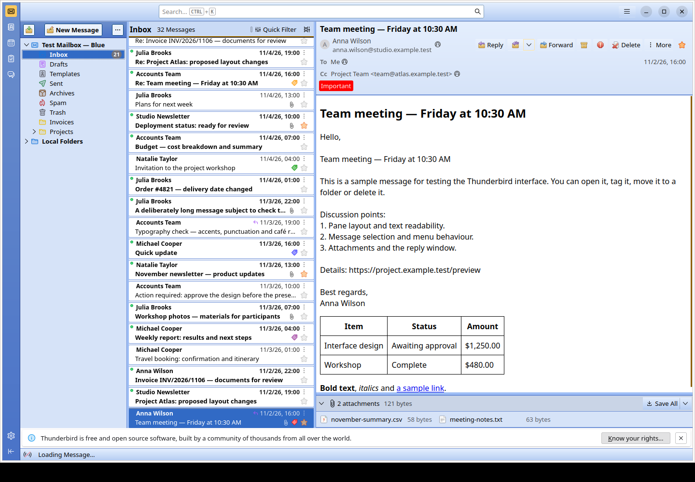

# Thunderbird 2003

An **Outlook 2003 / Office 2003-inspired appearance for Mozilla Thunderbird**,
with six colour variants, classic gradients, compact controls and a set of
15 original SVG action icons.

This is a visual customization of Thunderbird. Your mail accounts, message
storage and native mail commands are still handled by Thunderbird. It is an
independent project, not an official Microsoft or Mozilla theme.



## Design inspiration

The Blue variant takes its visual cues from the Windows XP Luna and Office 2003
era: blue navigation panels, soft toolbar gradients, warm hover highlights,
small borders and colourful envelope-and-arrow icons. The other variants
apply the same visual language to silver, charcoal, warm brown, sage green
and dark violet palettes.

The SVG icons are original drawings inspired by that period, rather than
extracted Outlook artwork. They cover New Message, Get Messages, Reply,
Reply All, Reply to List, Forward, Delete, Archive, Junk, Attach, Send, Save,
Contacts, Spelling and Print.

## Variants

| Folder | Name | Appearance | Screenshot |
|---|---|---|---|
| `Theme/blue/` | Blue / Luna | Light blue, closest to the original inspiration | [View](docs/screenshots/blue-mail.png) |
| `Theme/silver/` | Silver | Light silver and muted lavender | [View](docs/screenshots/silver-mail.png) |
| `Theme/graphite/` | Graphite | Dark charcoal with amber highlights | [View](docs/screenshots/graphite-mail.png) |
| `Theme/mocha/` | Mocha | Warm beige and brown | [View](docs/screenshots/mocha-mail.png) |
| `Theme/sage/` | Sage | Light sage green | [View](docs/screenshots/sage-mail.png) |
| `Theme/aurora/` | Aurora | Dark violet with turquoise highlights | [View](docs/screenshots/aurora-mail.png) |

## What is included

- A colour-theme `.xpi` for each variant.
- `userChrome.css` for the application interface and `userContent.css` for
  message typography and the compose editor's surface.
- A required `icons/` folder containing the SVG graphics and button mappings.
- A 13 px interface and a prominent 16 px subject in the **received-message
  preview header**. The compose Subject field keeps its regular surface and
  size, matching the sender field.
- Templates, palette definitions, a Python builder, fictional mail fixtures
  and a real-window screenshot test harness.

## Compatibility

The themes have been tested with **Thunderbird 159.0 on Linux**, using English
and Polish interfaces. Windows installation uses the same theme files, but
Windows rendering has not yet been tested. macOS has not been tested.

The XPI manifests declare Thunderbird 115 as the minimum version. That
metadata is not a claim that every CSS selector has been validated on every
release since 115. Interface updates may require CSS adjustments.

No Python, Xvfb, Openbox or additional extension is needed for manual theme
installation. Python and the Linux GUI tools are used only for development.

## Installation

Use the XPI, both CSS files and the entire icons folder from **one matching
variant**. Installing only the XPI applies the colour theme, not the complete
interface customization.

1. Download this repository using **Code → Download ZIP**, or clone it, and
   extract the files. Choose a folder such as `Theme/blue/`.
2. In Thunderbird, open **Add-ons and Themes**, click the gear menu and select
   **Install Add-on From File…**. Select `outlook2003-blue-theme.xpi`, then
   enable the theme.
3. Open **Settings → General → Config Editor…** at the bottom of the page.
   Set this preference to `true`:

   ```text
   toolkit.legacyUserProfileCustomizations.stylesheets
   ```

4. Open **Help → Troubleshooting Information**. Next to **Profile Folder**,
   choose **Open Folder** or the equivalent button on your platform. Leave
   the folder open and close Thunderbird.
5. In that profile folder, create a folder named `chrome` if it does not
   exist. Copy these items from the chosen variant into it:

   ```text
   <your Thunderbird profile>/
   └── chrome/
       ├── userChrome.css
       ├── userContent.css
       └── icons/
           ├── buttons.css
           └── … all 15 SVG files
   ```

   Preserve the directory structure: `icons/` must be beside the CSS files.
   On Windows, make sure the filenames end in `.css`, not `.css.txt`.
6. Start Thunderbird again.

The active profile is the destination, not Thunderbird's program installation
folder. On a conventional Windows installation, profiles are usually under
`%APPDATA%\Thunderbird\Profiles\`; opening the active profile through
Troubleshooting Information avoids choosing the wrong one.

If you already use custom CSS, keep a copy of it before replacing these files.
The files in this repository provide a complete stylesheet, not a patch to
arbitrary existing customizations.

For official background, see Mozilla's instructions for
[installing an XPI](https://support.mozilla.org/en-US/kb/installing-addon-thunderbird),
the [Config Editor](https://support.mozilla.org/en-US/kb/config-editor) and
[locating a Thunderbird profile](https://support.mozilla.org/en-US/kb/profiles-where-thunderbird-stores-user-data).

### Match the layout in the screenshots

The screenshots use **Cards View**, two-row message cards and a **Vertical
View** layout: folders, message list and message preview side by side. These
are Thunderbird preferences and are not set automatically by installing the
theme. Select Cards View in the message-list display options and choose the
vertical layout under **View → Layout**.

The generated demo profiles apply these settings automatically.

### Switch, update or remove

To switch variants, enable the new variant's XPI and replace both CSS files
and `icons/` with the matching files. Restart Thunderbird.

To update a variant, close Thunderbird, replace the relevant files with the
new version and restart it. Include any updated SVG files and button CSS.

To disable this customization, close Thunderbird and rename the supplied
stylesheets, for example to `userChrome.css.disabled` and
`userContent.css.disabled`. Reopen Thunderbird and select another theme in
Add-ons and Themes. Restore your previous custom CSS if you had one.

## Screenshots and current limitations

[Blue compose window](docs/screenshots/blue-compose.png) ·
[Aurora compose window](docs/screenshots/aurora-compose.png) ·
[Aurora account settings](docs/screenshots/aurora-account-settings.png)

The screenshots are real captures of Thunderbird 159.0 with fictional English
mail, taken on Linux in Xvfb with Openbox. No real mailbox credentials are
included. They show the current design without a separately tinted compose
Subject field.

Account settings retain more of Thunderbird's native styling than the main
mail view. Light and dark appearances work, but those pages do not yet fully
follow every custom palette. Native window decorations also depend on the
operating system and window manager.

The historical English test run covered all six themes and produced 84
screenshots, including 36 account-setting views. It checked the inbox,
message preview, attachments, menus, composer, button states and selected
layout measurements at a 1440 × 1000 desktop resolution. It was a graphical
smoke test, not a complete accessibility or DPI-scaling audit. The selected
screenshots are included here; complete test runs are generated locally.

## Repository layout

```text
Theme/<variant>/       Ready-to-install XPI, stylesheets and icons
Theme/gen/             Source templates, palettes and SVG files
tools/                 Builder support, demo mail and capture tests
TestProfiles/open.sh   Launcher for locally generated Polish demo profiles
docs/screenshots/      Selected real screenshots using English sample mail
AGENTS.md              Instructions for contributors and coding agents
```

Generated profiles, downloaded runtimes and full capture runs are ignored by
Git. They are not required to install a theme.

## Development and testing

Python 3.10 or newer with its standard library is sufficient to build themes, generate
fixtures and run the offline tests. The optional download helper requires
Bash, curl, tar/xz, awk and sha512sum on Linux x86_64. Real-window capture
also requires Xvfb, Openbox (or an already running window manager), xdotool,
xprop and ImageMagick's `import` command, plus the normal Thunderbird runtime
libraries. There is no npm build step or Python package installation.

### Build all variants

From the repository root:

```bash
python3 -B Theme/gen/build.py
```

Edit the templates, palettes and original icons in `Theme/gen/`, then rebuild
all six variants. The builder reports selected contrast checks; these are not
a full WCAG audit. The existing Blue XPI supplies the base manifest metadata.

### Run offline checks

These tests work from a fresh clone without a Thunderbird installation or
pre-existing demo profiles:

```bash
python3 -B tools/test_capture_test_profiles.py
python3 -B tools/test_english_mail.py
```

### Create English demo mailboxes

```bash
python3 -B tools/create_test_profiles.py --locale en-US
python3 -B tools/create_test_profiles.py --locale en-US --check
```

This creates `TestProfiles-en-US/<variant>/` and a launcher. Each profile has
72 messages, 38 initially unread messages, 25 messages with attachments and
16 replies. Fixtures include plain text, HTML tables, long subjects, tags,
CSV and TXT attachments, and Projects/Atlas and Invoices folders. The
POP3/SMTP endpoints are `127.0.0.1:65534`, automatic checking is disabled and
the launcher starts offline. These fixtures do not provide live mail delivery.

The generator refuses to overwrite existing profiles. After changing the
source themes, generate new profiles in a fresh directory, for example:

```bash
python3 -B tools/create_test_profiles.py --locale en-US --output TestProfiles-en-US-next
```

For Polish fixtures, omit `--locale en-US`. See
[TestProfiles/README.md](TestProfiles/README.md).

### Run real Thunderbird captures on Linux

Download the pinned English Thunderbird 159.0 build, or set
`THUNDERBIRD_BINARY` to the full path of a compatible local executable:

```bash
bash tools/download_thunderbird.sh en-US
./TestProfiles-en-US/open.sh blue
```

Close the manually opened test window before starting the automated run:

```bash
xvfb-run -a -s '-screen 0 1440x1000x24 -nolisten tcp' \
  python3 -B tools/capture_test_profiles.py \
  --locale en-US --output artifacts/gui-en-US
```

The helper verifies the downloaded archive against Mozilla's SHA-512 list.
The capture harness uses disposable profile copies, starts Openbox when the
display has no window manager, and enables Marionette system access only
for the test process. It keeps native Thunderbird security features enabled.

Use a fresh `--output` directory on each run. For regenerated source profiles,
pass `--profiles TestProfiles-en-US-next`. Optional variant arguments, such
as `blue aurora`, limit the capture run. English captures include six account
settings views per variant, including the SMTP editor, which is closed with
Cancel.
